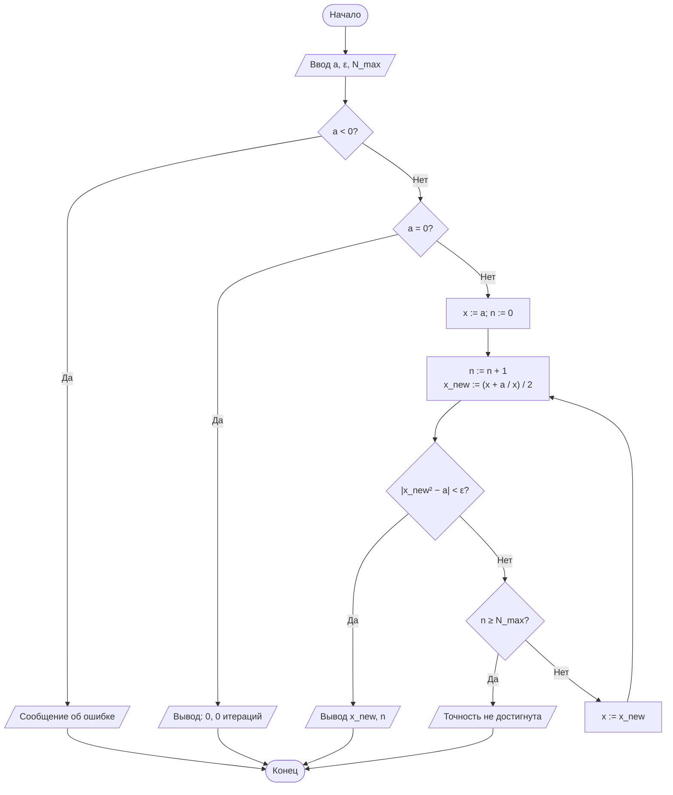
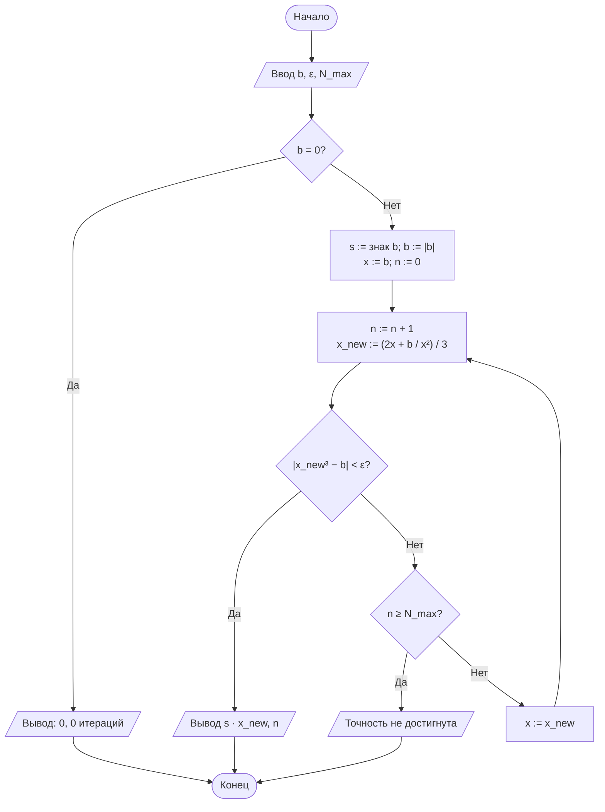
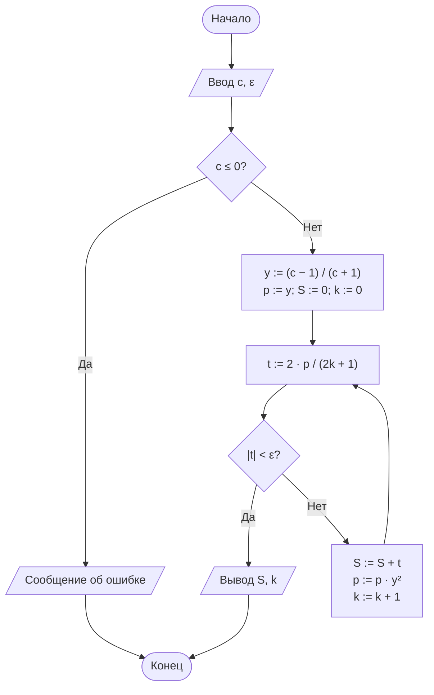

# Отчёт по лабораторной работе № 1

## Итерационные методы вычисления элементарных функций: квадратный корень, кубический корень и натуральный логарифм

---

## 1. Титульный лист

| | |
|---|---|
| **Дисциплина** | Теория алгоритмов |
| **Направление подготовки** | 38.03.05 «Бизнес-информатика» |
| **Курс** | 2 |
| **Лабораторная работа** | № 1. Итерационные методы вычисления элементарных функций: квадратный корень, кубический корень и натуральный логарифм |
| **Вариант** | 19 |
| **Выполнила** | Ситникова Ольга Алексеевна, группа БИ2-1 |
| **Проверил** | ______________________ |
| **Год** | 2026 |

---

## 2. Цель работы и задание варианта

**Цель работы:** сформировать представление об итерационных алгоритмах как о классе вычислительных процедур, результат которых достигается последовательным уточнением приближений, и освоить приёмы оценки их сходимости и трудоёмкости.

**Задание варианта 19:**

| Параметр | Значение |
|---|---|
| Подкоренное число a для √a | 53 |
| Число b для ∛b | 300 |
| Аргумент c для ln c | 6 |
| Точность ε | 10⁻⁴ |
| Критерий остановки (для корней) | Н — по невязке: модуль невязки меньше ε (x² − a для √a и x³ − b для ∛b) |
| Критерий остановки (для логарифма) | по модулю очередного члена ряда |
| Начальное приближение | x₀ = a (для ∛b: x₀ = b) |
| Дополнительное требование | Д1 — таблица итераций для каждой функции (номер шага, xₙ, разность соседних приближений) и анализ изменения числа верных знаков от шага к шагу |

**Что выполнено:**

1. Реализованы три функции без использования `math.sqrt`, `math.log` и `**0.5` внутри вычислительных функций: `sqrt_newton`, `cbrt_newton`, `ln_series`; каждая возвращает пару «результат, число итераций».
2. Выполнены расчёты для исходных данных варианта и проведено сравнение с эталоном из модуля `math` (эталон используется только в главной части программы).
3. Построены таблицы итераций (Д1) с невязкой, погрешностью и числом верных знаков.
4. Построен график зависимости погрешности от номера итерации (логарифмическая шкала).
5. Выполнена проверка входных данных: для отрицательного подкоренного числа и неположительного аргумента логарифма выдаются понятные сообщения об ошибке.

---

## 3. Краткие теоретические сведения

### 3.1. Итерационный алгоритм

**Итерационным** называется алгоритм, в котором искомая величина x* получается как предел последовательности приближений x₀, x₁, x₂, …, где каждое следующее приближение вычисляется по предыдущему по фиксированному правилу (итерационной формуле): x(n+1) = φ(xₙ).

Любой итерационный алгоритм определяется тремя элементами:

| Элемент | Содержание |
|---|---|
| Начальное приближение x₀ | Стартовое значение, от которого зависит число итераций, а иногда и сама сходимость |
| Итерационная формула φ | Правило перехода от xₙ к x(n+1) |
| Критерий остановки | Условие, при выполнении которого вычисления прекращаются |

Используемые критерии остановки:

- **по разности соседних приближений:** |x(n+1) − xₙ| < ε;
- **по невязке** (критерий варианта 19): |F(xₙ)| < ε, где F(x) = 0 — решаемое уравнение (F(x) = x² − a для √a и F(x) = x³ − b для ∛b);
- **по предельному числу итераций** N_max — страховка от зацикливания, если сходимости нет.

Итерационный процесс в общем случае не обязан завершаться за конечное число шагов; свойство результативности обеспечивается критерием остановки.

### 3.2. Скорость сходимости

Пусть eₙ = |xₙ − x*| — погрешность на n-м шаге. Процесс сходится с порядком p, если e(n+1) ≈ C · eₙ^p.

- p = 1 (линейная сходимость): число верных знаков растёт на постоянную величину за итерацию;
- p = 2 (квадратичная сходимость): число верных знаков примерно **удваивается** на каждой итерации.

Метод Ньютона при удачном выборе x₀ сходится квадратично; ряд для логарифма — линейно.

### 3.3. Метод Ньютона

Для решения уравнения F(x) = 0 строится последовательность x(n+1) = xₙ − F(xₙ) / F′(xₙ) (x(n+1) — точка пересечения касательной к графику F в точке xₙ с осью абсцисс).

**Квадратный корень.** F(x) = x² − a, F′(x) = 2x, откуда

x(n+1) = (xₙ + a / xₙ) / 2 — формула Герона.

**Кубический корень.** F(x) = x³ − b, F′(x) = 3x², откуда

x(n+1) = (2xₙ + b / xₙ²) / 3.

Для отрицательного b используется тождество ∛b = −∛|b|: метод применяется к модулю, а знак восстанавливается в конце.

**Начальное приближение.** В варианте 19 задано x₀ = a (для кубического корня x₀ = b), то есть расчёт начинается с самого аргумента. Для a = 53 и b = 300 это далеко от корней (≈ 7,28 и ≈ 6,69), что влияет на число итераций (раздел 7).

### 3.4. Вычисление натурального логарифма с помощью ряда

Ряд для ln(1 + x) сходится только при −1 < x ≤ 1 и медленно, поэтому применяется преобразованный ряд

ln c = 2 · (y + y³/3 + y⁵/5 + y⁷/7 + …), где y = (c − 1) / (c + 1).

При любом c > 0 выполняется |y| < 1, значит, ряд сходится для всех положительных аргументов. Члены вычисляются итеративно: степень умножается на y²; k-й член tₖ = 2 · y^(2k+1) / (2k + 1). Суммирование прекращается, когда |tₖ| < ε.

Для c = 6: y = 5/7 ≈ 0,714, y² ≈ 0,510. Погрешность убывает примерно в y² ≈ 0,51 раза за член, то есть **примерно на 0,29 десятичного знака** за член (около 3,4 члена на один верный знак).

### 3.5. Трудоёмкость

Трудоёмкость оценивается числом итераций N(ε), необходимым для достижения точности ε:

| Метод | Порядок сходимости | Оценка N(ε) |
|---|---|---|
| Метод Ньютона (квадратный и кубический корни) | 2 | O(log log (1/ε)) |
| Ряд для ln (без нормализации) | 1 | O(log (1/ε) / log (1/y)), где y — модуль величины (c − 1) / (c + 1) |

---

## 4. Блок-схемы алгоритмов

### 4.1. Вычисление квадратного корня



### 4.2. Вычисление кубического корня



### 4.3. Вычисление натурального логарифма



---

## 5. Листинг программы

Файл `lab1_variant19.py` (Python 3.10+, для графика нужна библиотека `matplotlib`). Каждая строка снабжена пояснением в строке над ней.

```python
"""Лабораторная работа № 1. Вариант 19. Ситникова Ольга Алексеевна, группа БИ2-1.
Итерационные методы вычисления √a, ∛b и ln c.

Исходные данные варианта 19: a = 53, b = 300, c = 6, точность eps = 1e-4,
критерий остановки для корней — по невязке (|x² − a| < eps и |x³ − b| < eps), начальное приближение x0 = a (b),
дополнительное требование Д1 — таблица итераций с анализом числа верных знаков.

Как устроена программа (удобно для рассказа на защите):
  1. sqrt_newton — квадратный корень методом Ньютона (формула Герона).
  2. cbrt_newton — кубический корень методом Ньютона (с учётом знака числа).
  3. ln_series — натуральный логарифм через ряд по степеням y = (c − 1) / (c + 1).
  4. Каждая функция возвращает пару (результат, число итераций) и умеет по запросу записывать ход итераций (trace) —
     это нужно для таблицы Д1.
  5. Главная часть (внизу): считает три значения, сравнивает с эталоном из модуля math (только там!),
     печатает таблицы итераций Д1 и строит график скорости сходимости.

Важно: комментарии в Python начинаются с символа #, а не с //  (две косые черты в Python — это целочисленное деление).
Каждая строка кода ниже имеет пояснение в строке над ней.
"""
# Модуль math используется ТОЛЬКО в главной части — для эталонных значений и подсчёта верных знаков.
# Внутри вычислительных функций math.sqrt, math.log и степень **0.5 не применяются (требование задания).
import math
# Модуль platform нужен, чтобы напечатать сведения о компьютере и версии Python (для условий в отчёте).
import platform
# Библиотека matplotlib строит графики; plt — короткое имя для неё.
import matplotlib.pyplot as plt

# Исходные данные варианта 19: a — число под квадратным корнем, b — под кубическим корнем, c — аргумент логарифма.
A, B, C = 53, 300, 6
# EPS — требуемая точность (10 в степени минус 4); N_MAX — страховка: максимум итераций, чтобы не зациклиться.
EPS, N_MAX = 1e-4, 100


# Функция вычисляет квадратный корень числа a методом Ньютона (формула Герона).
# Возвращает пару: (найденное значение, число выполненных итераций).
# trace — необязательный список: если он передан, в него записывается ход итераций (для таблицы Д1).
def sqrt_newton(a, eps=EPS, n_max=N_MAX, trace=None):
    # Корень из отрицательного числа в вещественных числах не существует — сообщаем об ошибке.
    if a < 0:
        # Исключение ValueError с понятным сообщением прервёт работу функции.
        raise ValueError("Подкоренное выражение должно быть неотрицательным")
    # Корень из нуля равен нулю, итераций не требуется.
    if a == 0:
        # Возвращаем пару «результат, число итераций».
        return 0.0, 0
    # Начальное приближение x0 = a (так задано вариантом 19).
    x = a
    # Повторяем уточнение не более n_max раз; n — номер текущей итерации (1, 2, 3, …).
    for n in range(1, n_max + 1):
        # Формула Герона: новое приближение — среднее арифметическое x и a / x.
        x_new = 0.5 * (x + a / x)
        # Если нужно записать ход итераций…
        if trace is not None:
            # …добавляем строку: номер шага, новое приближение и его отличие от предыдущего.
            trace.append((n, x_new, abs(x_new - x)))
        # Критерий остановки «по невязке»: квадрат приближения должен отличаться от a меньше чем на eps.
        if abs(x_new * x_new - a) < eps:
            # Точность достигнута — возвращаем результат и число итераций.
            return x_new, n
        # Иначе принимаем новое приближение за текущее и идём на следующий шаг.
        x = x_new
    # Если цикл закончился, а точность не достигнута — сообщаем об ошибке (сработала страховка n_max).
    raise RuntimeError("Точность не достигнута за N_MAX итераций")


# Функция вычисляет кубический корень числа b методом Ньютона; для отрицательных b учитывает знак.
# Возвращает пару: (найденное значение, число выполненных итераций).
def cbrt_newton(b, eps=EPS, n_max=N_MAX, trace=None):
    # Кубический корень из нуля равен нулю.
    if b == 0:
        # Итераций не требуется.
        return 0.0, 0
    # Запоминаем знак числа: для отрицательного b корень отрицателен (∛(−8) = −2).
    sign = -1 if b < 0 else 1
    # Дальше работаем с модулем числа, а знак вернём в самом конце.
    b = abs(b)
    # Начальное приближение x0 = b (так задано вариантом 19: x0 равно самому аргументу).
    x = b
    # Повторяем уточнение не более n_max раз.
    for n in range(1, n_max + 1):
        # Формула Ньютона для кубического корня: (2x + b / x²) / 3.
        x_new = (2 * x + b / (x * x)) / 3
        # Если нужно записать ход итераций…
        if trace is not None:
            # …добавляем строку: номер шага, новое приближение и его отличие от предыдущего.
            trace.append((n, x_new, abs(x_new - x)))
        # Критерий остановки «по невязке»: куб приближения должен отличаться от b меньше чем на eps.
        if abs(x_new * x_new * x_new - b) < eps:
            # Точность достигнута — возвращаем результат (с восстановленным знаком) и число итераций.
            return sign * x_new, n
        # Иначе принимаем новое приближение за текущее.
        x = x_new
    # Страховка: точность не достигнута за n_max итераций.
    raise RuntimeError("Точность не достигнута за N_MAX итераций")


# Функция вычисляет натуральный логарифм ln c через ряд ln c = 2·(y + y³/3 + y⁵/5 + …), где y = (c − 1) / (c + 1).
# Для логарифма критерий остановки всегда один: модуль очередного члена ряда меньше eps.
# Возвращает пару: (найденное значение, число сложенных членов ряда).
def ln_series(c, eps=EPS, n_max=10_000, trace=None):
    # Логарифм определён только для положительных чисел.
    if c <= 0:
        # Сообщаем об ошибке.
        raise ValueError("Аргумент логарифма должен быть положительным")
    # Вспомогательная величина y: при любом c > 0 выполняется |y| < 1, поэтому ряд сходится.
    y = (c - 1) / (c + 1)
    # Квадрат y: на него умножаем степень при переходе к следующему члену ряда.
    y2 = y * y
    # power — текущая нечётная степень y (сначала y в первой степени).
    power = y
    # total — накопленная сумма ряда (сначала ноль).
    total = 0.0
    # Перебираем члены ряда; k — номер члена, начиная с нуля.
    for k in range(n_max):
        # k-й член ряда: 2 · y^(2k+1) / (2k+1).
        term = 2 * power / (2 * k + 1)
        # Если член стал по модулю меньше eps, то ряд можно прекращать суммировать.
        if abs(term) < eps:
            # Возвращаем сумму и число уже сложенных членов (k).
            return total, k
        # Иначе прибавляем член к сумме.
        total += term
        # Если нужно записать ход итераций…
        if trace is not None:
            # …добавляем строку: сколько членов сложено, текущая сумма и последний добавленный член.
            trace.append((k + 1, total, abs(term)))
        # Готовим следующую степень: умножаем на y², получаем y^(2k+3).
        power *= y2
    # Страховка: точность не достигнута за n_max членов.
    raise RuntimeError("Точность не достигнута за n_max итераций")


# Функция correct_digits считает, сколько верных десятичных знаков у приближения, зная погрешность err.
def correct_digits(err):
    # Если погрешность равна нулю (в пределах точности чисел float), верны все знаки — условно возвращаем 16.
    if err == 0:
        # Число 16 — это примерно столько десятичных знаков помещается в тип float.
        return 16
    # Число верных знаков — это целая часть от «минус десятичный логарифм погрешности», но не меньше нуля.
    return max(0, math.floor(-math.log10(err)))


# Функция show_table печатает таблицу итераций Д1 для одной функции.
# name — название, x0 — начальное значение, rows — записанный ход итераций, ref — эталонное значение,
# resid — функция невязки (или None), если невязку показывать не нужно.
def show_table(name, x0, rows, ref, resid):
    # Заголовок таблицы с названием функции и эталонным значением (перевод строки \n даёт пустую строку перед заголовком).
    print(f"\nТаблица итераций Д1: {name} (эталон {ref:.10f})")
    # Заголовок столбцов: номер шага, приближение, разность соседних приближений, невязка, погрешность, верные знаки.
    print(f"{'n':>3} {'x_n':>16} {'|x_n - x_(n-1)|':>16} {'невязка':>12} {'погрешность':>13} {'верных знаков':>14}")
    # Нулевая строка — начальное приближение (разности и верных знаков для него не считаем).
    print(f"{0:>3} {x0:>16.8f} {'—':>16} {'—':>12} {abs(x0 - ref):>13.3e} {correct_digits(abs(x0 - ref)):>14}")
    # Перебираем записанные шаги: n — номер, x — приближение, diff — разность с предыдущим приближением.
    for n, x, diff in rows:
        # Невязка считается только если передана функция resid; иначе ставим прочерк.
        r = f"{abs(resid(x)):>12.3e}" if resid else f"{'—':>12}"
        # Погрешность — это отличие приближения от эталона.
        err = abs(x - ref)
        # Печатаем строку таблицы.
        print(f"{n:>3} {x:>16.8f} {diff:>16.3e} {r} {err:>13.3e} {correct_digits(err):>14}")


# Следующий блок выполняется, только если файл запущен напрямую (а не подключён как модуль).
if __name__ == "__main__":
    # Печатаем сведения о системе и версии Python.
    print(platform.platform(), "|", platform.processor() or platform.machine(), "| Python", platform.python_version())
    # Эталонные значения из стандартной библиотеки (math разрешён только здесь): √a, ∛b и ln c.
    ref_sqrt, ref_cbrt, ref_ln = math.sqrt(A), B ** (1 / 3), math.log(C)
    # Списки, в которые функции запишут ход итераций (для таблиц Д1 и графика).
    tr_sqrt, tr_cbrt, tr_ln = [], [], []
    # Вычисляем три значения; каждая функция возвращает пару (результат, число итераций).
    v_sqrt, n_sqrt = sqrt_newton(A, trace=tr_sqrt)
    # Кубический корень из 300.
    v_cbrt, n_cbrt = cbrt_newton(B, trace=tr_cbrt)
    # Натуральный логарифм числа 6.
    v_ln, n_ln = ln_series(C, trace=tr_ln)
    # Заголовок итоговой таблицы результатов.
    print(f"\nРезультаты (eps = {EPS}):")
    # Заголовок столбцов итоговой таблицы.
    print(f"{'Функция':<10}{'Аргумент':>10}{'Результат':>16}{'Эталон':>16}{'Погрешность':>14}{'Итераций':>10}")
    # Перебираем три функции: название, аргумент, результат, эталон и число итераций.
    for name, arg, val, ref, n in (("sqrt", A, v_sqrt, ref_sqrt, n_sqrt), ("cbrt", B, v_cbrt, ref_cbrt, n_cbrt), ("ln", C, v_ln, ref_ln, n_ln)):
        # Печатаем строку: результат и эталон с 10 знаками, абсолютная погрешность в экспоненциальной форме.
        print(f"{name:<10}{arg:>10}{val:>16.10f}{ref:>16.10f}{abs(val - ref):>14.2e}{n:>10}")
    # Таблица Д1 для квадратного корня: x0 = a = 53, невязка = x² − a.
    show_table("√a, a = 53", A, tr_sqrt, ref_sqrt, lambda x: x * x - A)
    # Таблица Д1 для кубического корня: x0 = b = 300, невязка = x³ − b.
    show_table("∛b, b = 300", B, tr_cbrt, ref_cbrt, lambda x: x * x * x - B)
    # Таблица Д1 для логарифма: вместо x0 берём 0 (сумма ряда пока пуста), невязки у ряда нет.
    show_table("ln c, c = 6", 0.0, tr_ln, ref_ln, None)
    # Проверка защиты от некорректных данных: отрицательное подкоренное выражение и неположительный аргумент логарифма.
    for bad in (lambda: sqrt_newton(-4), lambda: ln_series(0)):
        # Пробуем выполнить вызов и перехватываем ожидаемую ошибку.
        try:
            # Вызов должен завершиться исключением ValueError.
            bad()
        # Если ошибка возникла — печатаем её текст (программа при этом не падает).
        except ValueError as e:
            # Сообщение об ошибке для пользователя.
            print("Проверка входных данных:", e)
    # Создаём график: по оси X — номер итерации, по оси Y — погрешность (логарифмическая шкала).
    fig, ax = plt.subplots(figsize=(8, 5))
    # Для каждой функции берём записанный ход итераций и эталон.
    for label, rows, ref in (("√a (Ньютон)", tr_sqrt, ref_sqrt), ("∛b (Ньютон)", tr_cbrt, ref_cbrt), ("ln c (ряд)", tr_ln, ref_ln)):
        # Рисуем погрешность |x_n − эталон| в зависимости от номера итерации; "o-" — точки, соединённые линией.
        ax.plot([r[0] for r in rows], [max(abs(r[1] - ref), 1e-17) for r in rows], "o-", label=label)
    # Горизонтальная красная пунктирная линия — требуемая точность eps.
    ax.axhline(EPS, color="red", linestyle="--", label="eps = 1e-4")
    # Подписи осей, заголовок и логарифмическая шкала по вертикали.
    ax.set(xlabel="Номер итерации n", ylabel="Погрешность |x_n − эталон|", title="Скорость сходимости (вариант 19)", yscale="log")
    # Сетка и легенда.
    ax.grid(True, alpha=0.3, which="both")
    # Легенда с названиями линий.
    ax.legend()
    # Автоматически расставляем элементы так, чтобы подписи не накладывались.
    plt.tight_layout()
    # Сохраняем график в файл lab1_graphs.png (он нужен для отчёта).
    plt.savefig("lab1_graphs.png", dpi=150)
    # Показываем график на экране.
    plt.show()
```

---

## 6. Результаты расчётов

**Условия:** Linux (Ubuntu 24.04), Python 3.12.3, matplotlib 3.11. Точность ε = 10⁻⁴; эталонные значения получены функциями `math.sqrt`, `math.log` и возведением в степень 1/3 (только в главной части программы).

**Таблица 1. Результаты вычислений (вариант 19, ε = 10⁻⁴)**

| Функция | Аргумент | Результат | Эталон (`math`) | Абс. погрешность | Число итераций |
|---|---|---|---|---|---|
| √a | 53 | 7,2801101904 | 7,2801098893 | 3,01 · 10⁻⁷ | 6 |
| ∛b | 300 | 6,6943295030 | 6,6943295008 | 2,20 · 10⁻⁹ | 13 |
| ln c | 6 | 1,7916064542 | 1,7917594692 | 1,53 · 10⁻⁴ | 10 |

Для логарифма «число итераций» — число сложенных членов ряда. Невязки при остановке: для √53 — 4,4 · 10⁻⁶ (< ε), для ∛300 — 2,96 · 10⁻⁷ (< ε).

### 6.1. Таблицы итераций (Д1)

Обозначения: xₙ — приближение после n-го шага (x₀ — начальное), Δₙ = |xₙ − x(n−1)| — разность соседних приближений, невязка — |F(xₙ)|, погрешность — |xₙ − x*| относительно эталона, «верных знаков» — целая часть от −lg(погрешности).

**Таблица 2. Квадратный корень, a = 53, x₀ = 53 (эталон 7,2801098893)**

| n | xₙ | Δₙ | Невязка (xₙ² − a по модулю) | Погрешность | Верных знаков |
|---|---|---|---|---|---|
| 0 | 53,00000000 | — | — | 4,572 · 10¹ | 0 |
| 1 | 27,00000000 | 2,600 · 10¹ | 6,760 · 10² | 1,972 · 10¹ | 0 |
| 2 | 14,48148148 | 1,252 · 10¹ | 1,567 · 10² | 7,201 | 0 |
| 3 | 9,07066401 | 5,411 | 2,928 · 10¹ | 1,791 | 0 |
| 4 | 7,45683808 | 1,614 | 2,604 | 1,767 · 10⁻¹ | 0 |
| 5 | 7,28220413 | 1,746 · 10⁻¹ | 3,050 · 10⁻² | 2,094 · 10⁻³ | 2 |
| 6 | 7,28011019 | 2,094 · 10⁻³ | 4,385 · 10⁻⁶ | 3,011 · 10⁻⁷ | 6 |

**Таблица 3. Кубический корень, b = 300, x₀ = 300 (эталон 6,6943295008)**

| n | xₙ | Δₙ | Невязка (xₙ³ − b по модулю) | Погрешность | Верных знаков |
|---|---|---|---|---|---|
| 0 | 300,00000000 | — | — | 2,933 · 10² | 0 |
| 1 | 200,00111111 | 1,000 · 10² | 8,000 · 10⁶ | 1,933 · 10² | 0 |
| 2 | 133,33657405 | 6,666 · 10¹ | 2,370 · 10⁶ | 1,266 · 10² | 0 |
| 3 | 88,89667409 | 4,444 · 10¹ | 7,022 · 10⁵ | 8,220 · 10¹ | 0 |
| 4 | 59,27710343 | 2,962 · 10¹ | 2,080 · 10⁵ | 5,258 · 10¹ | 0 |
| 5 | 39,54652837 | 1,973 · 10¹ | 6,155 · 10⁴ | 3,285 · 10¹ | 0 |
| 6 | 26,42829381 | 1,312 · 10¹ | 1,816 · 10⁴ | 1,973 · 10¹ | 0 |
| 7 | 17,76203575 | 8,666 | 5,304 · 10³ | 1,107 · 10¹ | 0 |
| 8 | 12,15832451 | 5,604 | 1,497 · 10³ | 5,464 | 0 |
| 9 | 8,78202590 | 3,376 | 3,773 · 10² | 2,088 | 0 |
| 10 | 7,15129753 | 1,631 | 6,572 · 10¹ | 4,570 · 10⁻¹ | 0 |
| 11 | 6,72290780 | 4,284 · 10⁻¹ | 3,859 | 2,858 · 10⁻² | 1 |
| 12 | 6,69445081 | 2,846 · 10⁻² | 1,631 · 10⁻² | 1,213 · 10⁻⁴ | 3 |
| 13 | 6,69432950 | 1,213 · 10⁻⁴ | 2,955 · 10⁻⁷ | 2,198 · 10⁻⁹ | 8 |

**Таблица 4. Натуральный логарифм, c = 6 (эталон 1,7917594692); xₙ — частичная сумма ряда после n членов, Δₙ — последний добавленный член**

| n | xₙ | Δₙ | Погрешность | Верных знаков |
|---|---|---|---|---|
| 0 | 0,00000000 | — | 1,792 | 0 |
| 1 | 1,42857143 | 1,429 | 3,632 · 10⁻¹ | 0 |
| 2 | 1,67152575 | 2,430 · 10⁻¹ | 1,202 · 10⁻¹ | 0 |
| 3 | 1,74589953 | 7,437 · 10⁻² | 4,586 · 10⁻² | 1 |
| 4 | 1,77300367 | 2,710 · 10⁻² | 1,876 · 10⁻² | 1 |
| 5 | 1,78375928 | 1,076 · 10⁻² | 8,000 · 10⁻³ | 2 |
| 6 | 1,78824910 | 4,490 · 10⁻³ | 3,510 · 10⁻³ | 2 |
| 7 | 1,79018741 | 1,938 · 10⁻³ | 1,572 · 10⁻³ | 2 |
| 8 | 1,79104448 | 8,571 · 10⁻⁴ | 7,150 · 10⁻⁴ | 3 |
| 9 | 1,79143032 | 3,858 · 10⁻⁴ | 3,291 · 10⁻⁴ | 3 |
| 10 | 1,79160645 | 1,761 · 10⁻⁴ | 1,530 · 10⁻⁴ | 3 |

Следующий (одиннадцатый) член ряда равен 8,13 · 10⁻⁵ < ε, поэтому суммирование прекращено после 10 членов.

### 6.2. График скорости сходимости


**Проверка входных данных.** Вызов `sqrt_newton(-4)` и `ln_series(0)` завершается исключением ValueError с сообщениями «Подкоренное выражение должно быть неотрицательным» и «Аргумент логарифма должен быть положительным».

---

## 7. Анализ результатов и выводы

### 7.1. Изменение числа верных знаков (Д1)

**Квадратный корень** (6 итераций). Первые четыре итерации (n = 1–4) число верных знаков не растёт: из-за удалённого x₀ = 53 погрешность убывает от 45,7 до 0,177, на каждом шаге примерно вдвое (при x ≫ √a шаг метода Ньютона уменьшает x почти вдвое). Затем наступает квадратичный режим: число верных знаков сначала равно 2 (n = 5), затем 6 (n = 6); величина −lg(погрешность) растёт 0,75 → 2,68 → 6,52, то есть в 2,4–3,6 раза за шаг. Выполняется e₆ ≈ C · e₅² с C = 0,0687, что совпадает с теоретической константой 1 / (2√a) = 0,0687.

**Кубический корень** (13 итераций). Первые десять итераций (n = 1–10) метод работает «вхолостую»: при x ≫ ∛b каждое приближение умножается примерно на 2/3 (300 → 200 → 133 → 89 → 59 → …), поэтому погрешность убывает линейно и верных знаков нет. Квадратичная сходимость начинается только вблизи корня: верных знаков 1 (n = 11), 3 (n = 12), 8 (n = 13); −lg(погрешность) равна 1,54 → 3,92 → 8,66, то есть растёт в 2,2–2,5 раза за шаг. Константа e₁₃ / e₁₂² = 0,149 совпадает с теоретической 1 / ∛b = 0,149.

**Логарифм** (10 членов ряда). Сходимость линейная: погрешность уменьшается примерно в 0,46–0,5 раза за член, что соответствует y² = 25/49 ≈ 0,51 (с поправкой на множитель (2k + 1)/(2k + 3)). Каждый член даёт в среднем 0,29 десятичного знака (lg(1 / y²) = 0,292): верных знаков 1 после третьего члена, 2 после пятого, 3 после восьмого. Число верных знаков растёт **равномерно**, а не удваивается, и для точности 10⁻⁴ потребовалось 10 членов.

### 7.2. Выводы

1. Все три алгоритма завершились при заданной точности ε = 10⁻⁴: √53 ≈ 7,28011019 (6 итераций), ∛300 ≈ 6,69432950 (13 итераций), ln 6 ≈ 1,79160645 (10 членов ряда).
2. У методов Ньютона фактическая погрешность (3,0 · 10⁻⁷ и 2,2 · 10⁻⁹) значительно меньше ε: квадратичная сходимость приводит к тому, что на последней итерации погрешность уменьшается сразу на несколько порядков, перепрыгивая через границу ε. Условие по невязке при этом выполнено с запасом (4,4 · 10⁻⁶ и 3,0 · 10⁻⁷).
3. Для ряда логарифма погрешность (1,53 · 10⁻⁴) **больше** ε = 10⁻⁴. Причина: критерий проверяет лишь последний член, а не остаток ряда, и при медленной (геометрической) сходимости сумма отброшенных членов примерно вдвое больше первого из них (1 / (1 − y²) ≈ 2,04: 8,13 · 10⁻⁵ → ≈ 1,5 · 10⁻⁴). Следовательно, критерий «член меньше ε» не гарантирует погрешность не больше ε при линейной сходимости; для надёжной оценки следует применять оценку остатка (тогда потребуется 11 членов: погрешность после 11 членов ≈ 7,2 · 10⁻⁵) или нормализацию аргумента.
4. Число итераций определяется удалённостью начального приближения. Задание x₀ = a (x₀ = b) неудачно для больших значений: кубический корень из 300 потребовал 13 итераций, из них 10 ушло на «подход» к корню. Для справки (дополнительный расчёт вне основной программы): при x₀ = 150 понадобилось 11 итераций, при x₀ = 1 — 11, при x₀ = 7 (близко к корню) — всего 3; для √53 при x₀ = 7 — 2 итерации вместо 6.
5. Метод Ньютона (порядок сходимости 2) эффективнее ряда (порядок 1) при высокой точности: вблизи корня число верных знаков удваивается, тогда как ряд даёт примерно 0,29 знака за член. Для логарифма больших и малых аргументов (|y| близко к 1) выгодна нормализация c = m · 2^k.
6. Недопустимые входные данные (отрицательное подкоренное число, неположительный аргумент логарифма) обрабатываются понятными сообщениями; предельное число итераций N_max = 100 защищает от зацикливания.

---

## 8. Ответы на контрольные вопросы

1. **Итерационный алгоритм** — алгоритм, в котором результат получается как предел последовательности приближений, каждое из которых вычисляется по предыдущему. Он дискретен (процесс разбит на шаги), детерминирован (одни и те же данные дают один результат) и массов (применим к любым допустимым входным данным); результативность (завершение за конечное число шагов) обеспечивается критерием остановки и ограничением N_max.
2. **Формула Герона.** Для F(x) = x² − a: F′(x) = 2x, x(n+1) = xₙ − (xₙ² − a) / (2xₙ) = (2xₙ² − xₙ² + a) / (2xₙ) = (xₙ + a / xₙ) / 2.
3. **Критерии остановки.** «По разности» проверяет, насколько изменилось приближение; «по невязке» — насколько точно оно удовлетворяет уравнению. Они могут давать разные результаты: если функция очень пологая (малая производная), невязка мала при заметной погрешности по x; если крутая — наоборот. На практике при x ≈ ∛300 невязка |x³ − b| = 3 · x² · e в 134 раза больше погрешности e, а для √53 невязка |x² − a| = 2√a · e ≈ 14,6 · e.
4. **Порядок сходимости** p показывает, как связаны последовательные погрешности: e(n+1) ≈ C · eₙ^p. Метод Ньютона (p = 2) удваивает число верных знаков за итерацию, а метод половинного деления (p = 1) лишь вдвое сокращает интервал, то есть даёт примерно 0,3 знака за шаг; поэтому Ньютон быстрее при высокой точности.
5. **Начальное приближение** определяет число итераций. Пример из расчётов: для ∛300 при x₀ = 300 потребовалось 13 итераций, при x₀ = 7 — 3.
6. Ряд ln(1 + x) сходится только при |x| ≤ 1: для ln 100 нужно x = 99, ряд расходится. Ряд с y = (c − 1)/(c + 1) сходится при любом c > 0, так как |y| < 1 (для c = 100: y = 99/101 ≈ 0,98).
7. **Нормализация** c = m · 2^k (m ∈ [0,5; 1)) приводит аргумент к области, где |y| ≤ 1/3, и ряд сходится в несколько раз быстрее; значение ln c получается как ln m + k · ln 2.
8. Фактическая погрешность часто значительно меньше ε из-за квадратичной сходимости (последний шаг «перепрыгивает» границу). Она может оказаться и больше ε, если критерий остановки не контролирует погрешность напрямую: в нашем расчёте ln 6 погрешность 1,53 · 10⁻⁴ превышает ε = 10⁻⁴.
9. Ограничение N_max нужно как страховка от зацикливания: при плохом начальном приближении или отсутствии сходимости процесс иначе не завершился бы, и результативность алгоритма была бы потеряна.
10. **Пример из бизнес-аналитики:** расчёт внутренней нормы доходности IRR проекта — корень уравнения NPV(r) = 0 методом Ньютона или половинного деления; расчёт эффективной процентной ставки по кредиту.
