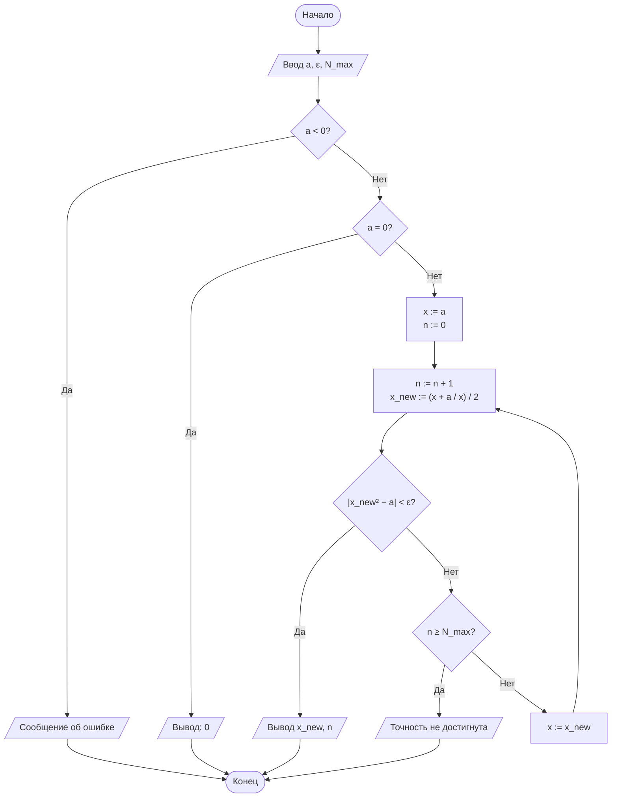
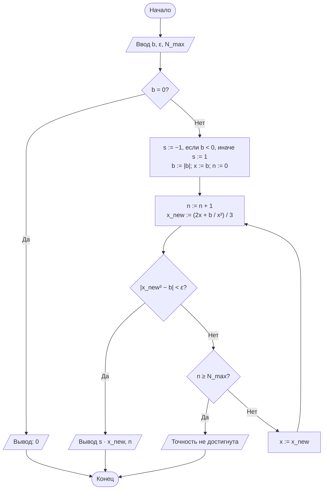
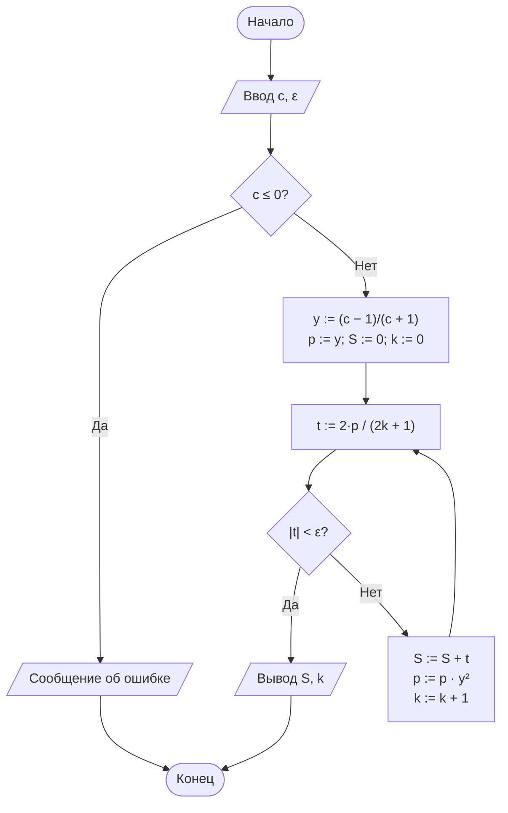

# Лабораторная работа № 1

## Итерационные методы вычисления элементарных функций: квадратный корень, кубический корень и натуральный логарифм

|  |  |
|---|---|
| **Дисциплина** | Теория алгоритмов |
| **Направление подготовки** | 38.03.05 «Бизнес-информатика» |
| **Курс** | 2 |
| **Группа** | БИ2-1 |
| **Выполнила** | Ситникова Ольга |
| **Вариант** | 19 |
| **Язык реализации** | Python 3.10+ |
| **Год** | 2026 |

---

## 1. Цель и задачи работы

**Цель работы:** сформировать представление об итерационных алгоритмах как о классе вычислительных процедур, результат которых достигается последовательным уточнением приближений, и освоить приёмы оценки их сходимости и трудоёмкости.

**Задачи:**

1. Изучить понятия итерационного процесса, начального приближения, критерия остановки и скорости сходимости.
2. Реализовать алгоритмы вычисления $\sqrt{a}$ и $\sqrt[3]{b}$ методом Ньютона, а также $\ln c$ методом разложения в степенной ряд.
3. Экспериментально определить число итераций, необходимое для достижения заданной точности $\varepsilon$.
4. Сравнить полученные значения с эталонными значениями стандартной библиотеки (`math`) и оценить абсолютную погрешность.

---

## 2. Задание варианта 19

**Таблица 1. Исходные данные варианта 19**

| № | $a$ для $\sqrt{a}$ | $b$ для $\sqrt[3]{b}$ | $c$ для $\ln c$ | $\varepsilon$ | Критерий | $x_0$ | Доп. |
|---|---|---|---|---|---|---|---|
| 19 | 53 | 300 | 6 | $10^{-4}$ | Н | $x_0 = a$ | Д1 |

Требуется вычислить $\sqrt{53}$, $\sqrt[3]{300}$ и $\ln 6$ с точностью $\varepsilon = 10^{-4}$.

- **Критерий остановки (Н) — по невязке.** Для квадратного корня: $\lvert x_n^2 - a \rvert < \varepsilon$. Для кубического корня аналогично: $\lvert x_n^3 - b \rvert < \varepsilon$. Для логарифма всегда используется критерий по модулю очередного члена ряда: $\lvert t_k \rvert < \varepsilon$.
- **Начальное приближение:** $x_0 = a$. Для кубического корня по аналогии берётся $x_0 = b$ (значение подкоренного выражения).
- **Дополнительное требование Д1:** вывести таблицу итераций для каждой функции (номер шага, $x_n$, $\lvert x_{n+1} - x_n \rvert$) и проанализировать, как меняется число верных знаков от шага к шагу.

---

## 3. Краткие теоретические сведения

### 3.1. Итерационный алгоритм

Итерационным называется алгоритм, в котором искомая величина $x^*$ получается как предел последовательности приближений $x_0, x_1, x_2, \ldots$, где каждое следующее приближение вычисляется по предыдущему по фиксированному правилу:

$$x_{n+1} = \varphi(x_n).$$

Алгоритм определяют три элемента: начальное приближение $x_0$, итерационная формула $\varphi$ и критерий остановки. Свойство результативности обеспечивается именно критерием остановки (и предельным числом итераций $N_{\max}$ как страховкой от зацикливания).

### 3.2. Метод Ньютона

Для уравнения $F(x) = 0$:

$$x_{n+1} = x_n - \frac{F(x_n)}{F'(x_n)}.$$

**Квадратный корень** ($F(x) = x^2 - a$, формула Герона):

$$x_{n+1} = \frac{1}{2}\left(x_n + \frac{a}{x_n}\right).$$

**Кубический корень** ($F(x) = x^3 - b$):

$$x_{n+1} = \frac{1}{3}\left(2x_n + \frac{b}{x_n^2}\right).$$

Для отрицательного $b$ используется тождество $\sqrt[3]{b} = -\sqrt[3]{\lvert b \rvert}$: метод применяется к модулю, а знак восстанавливается в конце. В варианте 19 $b = 300 > 0$, но программа обрабатывает и отрицательные значения.

Порядок сходимости метода Ньютона $p = 2$: вблизи корня число верных знаков примерно удваивается на каждой итерации.

### 3.3. Натуральный логарифм через ряд

$$\ln c = 2\left(y + \frac{y^3}{3} + \frac{y^5}{5} + \frac{y^7}{7} + \ldots\right), \qquad y = \frac{c-1}{c+1}.$$

Для любого $c > 0$ выполнено $\lvert y \rvert < 1$, поэтому ряд сходится. Члены считаются итеративно: степень $y^{2k+1}$ умножается на $y^2$, член ряда равен

$$t_k = \frac{2\,y^{2k+1}}{2k+1},$$

а суммирование прекращается, когда $\lvert t_k \rvert < \varepsilon$. Для $c = 6$ получаем $y = 5/7 \approx 0{,}714$, $y^2 \approx 0{,}510$. Ряд сходится линейно с множителем $\approx y^2$.

---

## 4. Блок-схемы алгоритмов

### 4.1. Вычисление квадратного корня (критерий по невязке, $x_0 = a$)



### 4.2. Вычисление кубического корня (критерий по невязке, $x_0 = b$)



### 4.3. Вычисление натурального логарифма



---

## 5. Листинг программы

Файл `lab1.py`. Запуск: `python lab1.py`.

```python
"""
Лабораторная работа № 1. Вариант 19.
Итерационные методы вычисления √a, ∛b, ln c.

Автор: Ситникова Ольга, группа БИ2-1.

Исходные данные варианта 19:
    a = 53, b = 300, c = 6, eps = 1e-4
    критерий остановки для корней: по невязке (Н)
    начальное приближение: x0 = a (для кубического корня x0 = b, т.е. аргумент)
    дополнительное требование: Д1 (таблица итераций и анализ верных знаков)
"""
import math
import sys

# Чтобы русские буквы корректно печатались в консоли Windows
if hasattr(sys.stdout, "reconfigure"):
    sys.stdout.reconfigure(encoding="utf-8")

# ---------------------------------------------------------------------------
# Исходные данные варианта
# ---------------------------------------------------------------------------
A, B, C = 53, 300, 6
EPS = 1e-4
N_MAX = 100


def sqrt_newton(a, eps=EPS, n_max=N_MAX, trace=None, x0=None):
    """Квадратный корень методом Ньютона (формула Герона).

    Критерий остановки: по невязке |x^2 - a| < eps.
    Начальное приближение: x0 = a (можно задать другое через параметр x0).
    Возвращает пару (результат, число итераций).
    Если передан список trace, в него записываются строки
    (n, x_n, |x_n - x_{n-1}|, |F(x_n)|) для каждой итерации.
    """
    if a < 0:
        raise ValueError("Подкоренное выражение должно быть неотрицательным")
    if a == 0:
        return 0.0, 0
    x = float(a if x0 is None else x0)  # по умолчанию x0 = a
    for n in range(1, n_max + 1):
        x_new = 0.5 * (x + a / x)
        residual = abs(x_new * x_new - a)
        if trace is not None:
            trace.append((n, x_new, abs(x_new - x), residual))
        if residual < eps:
            return x_new, n
        x = x_new
    raise RuntimeError("Точность не достигнута за N_MAX итераций")


def cbrt_newton(b, eps=EPS, n_max=N_MAX, trace=None, x0=None):
    """Кубический корень методом Ньютона (с учётом знака).

    Критерий остановки: по невязке |x^3 - |b|| < eps.
    Начальное приближение: x0 = |b| (можно задать другое через параметр x0).
    Возвращает пару (результат, число итераций).
    """
    if b == 0:
        return 0.0, 0
    sign = -1 if b < 0 else 1
    b = abs(b)
    x = float(b if x0 is None else x0)  # по умолчанию x0 = |b|
    for n in range(1, n_max + 1):
        x_new = (2 * x + b / (x * x)) / 3
        residual = abs(x_new ** 3 - b)
        if trace is not None:
            trace.append((n, sign * x_new, abs(x_new - x), residual))
        if residual < eps:
            return sign * x_new, n
        x = x_new
    raise RuntimeError("Точность не достигнута за N_MAX итераций")


def ln_series(c, eps=EPS, n_max=10_000, trace=None):
    """Натуральный логарифм через ряд 2*(y + y^3/3 + y^5/5 + ...),
    где y = (c - 1) / (c + 1).

    Критерий остановки: |t_k| < eps (модуль очередного члена ряда).
    Возвращает пару (результат, число итераций = число сложенных членов).
    Если передан trace, в него записываются (k, S_k, |t_k|).
    """
    if c <= 0:
        raise ValueError("Аргумент логарифма должен быть положительным")
    y = (c - 1) / (c + 1)
    y2 = y * y
    power = y          # текущая степень y^(2k+1)
    total = 0.0
    for k in range(n_max):
        term = 2 * power / (2 * k + 1)
        if abs(term) < eps:
            return total, k
        total += term
        if trace is not None:
            trace.append((k + 1, total, abs(term)))
        power *= y2
    raise RuntimeError("Точность не достигнута за n_max итераций")


def correct_digits(value, ref):
    """Число верных десятичных знаков: -lg|value - ref|."""
    err = abs(value - ref)
    if err == 0:
        return float("inf")
    return -math.log10(err)


def fmt_digits(d):
    """Форматирование числа верных знаков (отрицательные значения -> 0)."""
    if d == float("inf") or d > 16:
        return "≥16"
    return "0" if d <= 0 else f"{d:.1f}"


def print_trace_root(title, trace, ref):
    """Таблица итераций для метода Ньютона (формат Markdown)."""
    print(f"**{title}**\n")
    print("| n | x_n | \\|x_n − x_(n−1)\\| | \\|F(x_n)\\| | Погрешность \\|x_n − x*\\| | Верных знаков |")
    print("|---|---|---|---|---|---|")
    for n, x, diff, res in trace:
        err = abs(x - ref)
        print(f"| {n} | {x:.10f} | {diff:.3e} | {res:.3e} | {err:.3e} | {fmt_digits(correct_digits(x, ref))} |")
    print()


def print_trace_ln(title, trace, ref):
    """Таблица итераций для ряда ln (формат Markdown)."""
    print(f"**{title}**\n")
    print("| k | S_k | \\|t_k\\| | Погрешность \\|S_k − ln c\\| | Верных знаков |")
    print("|---|---|---|---|---|")
    for k, s, t in trace:
        err = abs(s - ref)
        print(f"| {k} | {s:.10f} | {t:.3e} | {err:.3e} | {fmt_digits(correct_digits(s, ref))} |")
    print()


def main():
    ref_sqrt = math.sqrt(A)      # эталоны — только для сравнения
    ref_cbrt = B ** (1 / 3)
    ref_ln = math.log(C)

    # ---- Основная таблица результатов -----------------------------------
    print(f"Вариант 19: a = {A}, b = {B}, c = {C}, eps = {EPS}\n")
    print("**Таблица результатов**\n")
    print("| Функция | Аргумент | Результат | Эталон (math) | Абс. погрешность | Число итераций |")
    print("|---|---|---|---|---|---|")
    for name, f, arg, ref in [("√a", sqrt_newton, A, ref_sqrt),
                              ("∛b", cbrt_newton, B, ref_cbrt),
                              ("ln c", ln_series, C, ref_ln)]:
        val, n = f(arg)
        print(f"| {name} | {arg} | {val:.10f} | {ref:.10f} | {abs(val - ref):.2e} | {n} |")
    print()

    # ---- Д1: таблицы итераций ------------------------------------------
    print("=" * 70)
    print("Д1. Таблицы итераций\n")

    t = []
    sqrt_newton(A, trace=t)
    print_trace_root(f"Таблица 4. √{A}, метод Ньютона, x0 = {A}", t, ref_sqrt)

    t = []
    cbrt_newton(B, trace=t)
    print_trace_root(f"Таблица 5. ∛{B}, метод Ньютона, x0 = {B}", t, ref_cbrt)

    t = []
    ln_series(C, trace=t)
    print_trace_ln(f"Таблица 6. ln {C}, ряд по y = (c−1)/(c+1)", t, ref_ln)


if __name__ == "__main__":
    main()
```

---

## 6. Результаты расчётов

**Таблица 3. Результаты вычислений (вариант 19, $\varepsilon = 10^{-4}$)**

| Функция | Аргумент | Результат | Эталон (math) | Абс. погрешность | Число итераций |
|---|---|---|---|---|---|
| √a | 53 | 7.2801101904 | 7.2801098893 | 3.01e-07 | 6 |
| ∛b | 300 | 6.6943295030 | 6.6943295008 | 2.20e-09 | 13 |
| ln c | 6 | 1.7916064542 | 1.7917594692 | 1.53e-04 | 10 |

Эталонные значения получены функциями `math.sqrt`, `math.log` и операцией `b ** (1 / 3)` и использованы только для сравнения. Вычислительные функции их не применяют.

### 6.1. Дополнительное требование Д1: таблицы итераций

В таблицах: $\lvert x_n - x_{n-1} \rvert$ — разность соседних приближений, $\lvert F(x_n) \rvert$ — невязка, «Верных знаков» — величина $-\lg \lvert x_n - x^* \rvert$ (где $x^*$ — эталон; значения $\le 0$ показаны как 0).

**Таблица 4. $\sqrt{53}$, метод Ньютона, $x_0 = 53$**

| n | x_n | \|x_n − x_(n−1)\| | \|F(x_n)\| | Погрешность \|x_n − x*\| | Верных знаков |
|---|---|---|---|---|---|
| 1 | 27.0000000000 | 2.600e+01 | 6.760e+02 | 1.972e+01 | 0 |
| 2 | 14.4814814815 | 1.252e+01 | 1.567e+02 | 7.201e+00 | 0 |
| 3 | 9.0706640144 | 5.411e+00 | 2.928e+01 | 1.791e+00 | 0 |
| 4 | 7.4568380797 | 1.614e+00 | 2.604e+00 | 1.767e-01 | 0.8 |
| 5 | 7.2822041317 | 1.746e-01 | 3.050e-02 | 2.094e-03 | 2.7 |
| 6 | 7.2801101904 | 2.094e-03 | 4.385e-06 | 3.011e-07 | 6.5 |

**Таблица 5. $\sqrt[3]{300}$, метод Ньютона, $x_0 = 300$**

| n | x_n | \|x_n − x_(n−1)\| | \|F(x_n)\| | Погрешность \|x_n − x*\| | Верных знаков |
|---|---|---|---|---|---|
| 1 | 200.0011111111 | 1.000e+02 | 8.000e+06 | 1.933e+02 | 0 |
| 2 | 133.3365740463 | 6.666e+01 | 2.370e+06 | 1.266e+02 | 0 |
| 3 | 88.8966740908 | 4.444e+01 | 7.022e+05 | 8.220e+01 | 0 |
| 4 | 59.2771034272 | 2.962e+01 | 2.080e+05 | 5.258e+01 | 0 |
| 5 | 39.5465283720 | 1.973e+01 | 6.155e+04 | 3.285e+01 | 0 |
| 6 | 26.4282938143 | 1.312e+01 | 1.816e+04 | 1.973e+01 | 0 |
| 7 | 17.7620357480 | 8.666e+00 | 5.304e+03 | 1.107e+01 | 0 |
| 8 | 12.1583245091 | 5.604e+00 | 1.497e+03 | 5.464e+00 | 0 |
| 9 | 8.7820258992 | 3.376e+00 | 3.773e+02 | 2.088e+00 | 0 |
| 10 | 7.1512975338 | 1.631e+00 | 6.572e+01 | 4.570e-01 | 0.3 |
| 11 | 6.7229078000 | 4.284e-01 | 3.859e+00 | 2.858e-02 | 1.5 |
| 12 | 6.6944508117 | 2.846e-02 | 1.631e-02 | 1.213e-04 | 3.9 |
| 13 | 6.6943295030 | 1.213e-04 | 2.955e-07 | 2.198e-09 | 8.7 |

**Таблица 6. $\ln 6$, ряд по $y = (c-1)/(c+1)$**

| k | S_k | \|t_k\| | Погрешность \|S_k − ln c\| | Верных знаков |
|---|---|---|---|---|
| 1 | 1.4285714286 | 1.429e+00 | 3.632e-01 | 0.4 |
| 2 | 1.6715257532 | 2.430e-01 | 1.202e-01 | 0.9 |
| 3 | 1.7458995260 | 7.437e-02 | 4.586e-02 | 1.3 |
| 4 | 1.7730036706 | 2.710e-02 | 1.876e-02 | 1.7 |
| 5 | 1.7837592836 | 1.076e-02 | 8.000e-03 | 2.1 |
| 6 | 1.7882491034 | 4.490e-03 | 3.510e-03 | 2.5 |
| 7 | 1.7901874087 | 1.938e-03 | 1.572e-03 | 2.8 |
| 8 | 1.7910444825 | 8.571e-04 | 7.150e-04 | 3.1 |
| 9 | 1.7914303200 | 3.858e-04 | 3.291e-04 | 3.5 |
| 10 | 1.7916064542 | 1.761e-04 | 1.530e-04 | 3.8 |

(В таблице 6 $S_k$ — частичная сумма после $k$ сложенных членов, $\lvert t_k \rvert$ — модуль последнего добавленного члена.)

**Как меняется число верных знаков:**

- **$\sqrt{53}$.** На первых трёх шагах приближение лишь уменьшается примерно вдвое ($53 \to 27 \to 14{,}5 \to 9{,}07$), верных знаков ещё нет. Затем начинается квадратичная фаза: $0{,}8 \to 2{,}7 \to 6{,}5$, то есть число верных знаков растёт в 2–3 раза за шаг.
- **$\sqrt[3]{300}$.** Начальное приближение очень далеко от корня ($300$ против $6{,}69$), поэтому первые 9 шагов $x_n$ убывает примерно в $3/2$ раза за шаг (линейная фаза, верных знаков нет). Квадратичный режим включается только вблизи корня: $0{,}3 \to 1{,}5 \to 3{,}9 \to 8{,}7$.
- **$\ln 6$.** Сходимость линейная: за шаг добавляется примерно $0{,}3$–$0{,}4$ верного знака (от $0{,}4$ до $3{,}8$ за 10 шагов). Это согласуется с оценкой $-\lg y^2 \approx 0{,}29$ для множителя $y^2 \approx 0{,}51$.

---

## 7. Анализ результатов и выводы

1. Все три алгоритма завершились за конечное число шагов: $\sqrt{53}$ — за 6 итераций, $\sqrt[3]{300}$ — за 13, $\ln 6$ — за 10 членов ряда.
2. Для методов Ньютона фактическая погрешность ($3{,}0 \cdot 10^{-7}$ и $2{,}2 \cdot 10^{-9}$) много меньше $\varepsilon = 10^{-4}$. Причина — квадратичная сходимость: на последнем шаге невязка ещё лишь $4{,}4 \cdot 10^{-6}$ и $3{,}0 \cdot 10^{-7}$, а погрешность корня примерно равна невязке, делённой на $F'(x^*)$ (для $\sqrt{53}$: $4{,}4 \cdot 10^{-6} / (2\sqrt{53}) \approx 3 \cdot 10^{-7}$).
3. Для $\sqrt[3]{300}$ потребовалось в два с лишним раза больше итераций, чем для $\sqrt{53}$: стартовая точка $x_0 = b = 300$ далека от корня $\approx 6{,}69$, и значительную часть шагов метод тратит на медленное линейное «спуск» к корню (таблица 5, шаги 1–10). Для сравнения (те же функции, параметр `x0`): для $\sqrt{53}$ при $x_0 = 53;\ 26{,}5;\ 1$ получается 6, 5 и 6 итераций, для $\sqrt[3]{300}$ при $x_0 = 300;\ 150;\ 1$ — 13, 11 и 11 итераций.
4. Для $\ln 6$ фактическая погрешность $1{,}53 \cdot 10^{-4}$ **больше** $\varepsilon = 10^{-4}$. Это не ошибка программы, а свойство критерия «по модулю члена ряда»: суммирование остановилось, когда очередной (11-й) член стал меньше $\varepsilon$ ($\approx 8{,}2 \cdot 10^{-5}$), но весь «хвост» ряда ($\approx 1{,}5 \cdot 10^{-4}$) при этом отброшен. Для гарантированной точности нужно либо брать более строгий $\varepsilon$, либо оценивать остаток ряда: $\lvert R_k \rvert \lesssim \lvert t_k \rvert \cdot y^2 / (1 - y^2)$.
5. Критерий по невязке и критерий по разности соседних приближений дают разное число шагов: для $\sqrt{53}$ критерий Н останавливается на 6-м шаге (при этом $\lvert x_6 - x_5 \rvert = 2{,}1 \cdot 10^{-3} > \varepsilon$), а критерий Р потребовал бы 7 шагов; для $\sqrt[3]{300}$ — 13 против 14 шагов.
6. Метод Ньютона (порядок 2) значительно эффективнее ряда для логарифма (порядок 1) по числу итераций при близких стартовых условиях. Для аргумента, далёкого от 1, ряд замедляется ($y \to 1$); для ускорения применяют нормализацию $c = m \cdot 2^k$.

---

## 8. Ответы на контрольные вопросы

**1. Дайте определение итерационного алгоритма. Какими свойствами алгоритма он обладает и как обеспечивается результативность?**
Итерационный алгоритм получает результат как предел последовательности приближений $x_{n+1} = \varphi(x_n)$. Он *дискретен* (процесс разбит на шаги), *детерминирован* (одинаковые данные дают одинаковый результат), *массов* (применим к любым допустимым $a$, $b$, $c$). *Результативность* сама по себе не гарантирована, так как предел достигается лишь в бесконечности; её обеспечивают критерий остановки и ограничение $N_{\max}$.

**2. Выведите формулу Герона из метода Ньютона.**
При $F(x) = x^2 - a$, $F'(x) = 2x$:
$x_{n+1} = x_n - \dfrac{x_n^2 - a}{2x_n} = \dfrac{2x_n^2 - x_n^2 + a}{2x_n} = \dfrac{1}{2}\left(x_n + \dfrac{a}{x_n}\right).$

**3. Чем отличаются критерии «по разности» и «по невязке»?**
Критерий по разности смотрит, насколько сдвинулось приближение, критерий по невязке — насколько хорошо оно удовлетворяет уравнению. Результаты могут расходиться: для $\sqrt{53}$ на 6-м шаге невязка $4{,}4 \cdot 10^{-6} < \varepsilon$ (критерий Н выполнен), а разность $2{,}1 \cdot 10^{-3} > \varepsilon$ (критерий Р ещё не выполнен). Невязка зависит от масштаба функции: при большом $F'$ малая невязка может соответствовать заметной погрешности по $x$, и наоборот.

**4. Что такое порядок сходимости? Почему метод Ньютона быстрее половинного деления?**
Процесс имеет порядок $p$, если $e_{n+1} \approx C e_n^{\,p}$. У метода Ньютона $p = 2$: число верных знаков примерно удваивается за шаг (в таблице 4: $0{,}8 \to 2{,}7 \to 6{,}5$). У половинного деления $p = 1$: погрешность уменьшается лишь вдвое за шаг, то есть добавляется около 0,3 десятичного знака.

**5. Как выбор начального приближения влияет на число итераций?**
Чем дальше $x_0$ от корня, тем больше шагов тратится на линейную фазу. Пример из расчётов: $\sqrt[3]{300}$ при $x_0 = 300$ требует 13 итераций, а при $x_0 = 150$ или $x_0 = 1$ — 11 итераций.

**6. Почему ряд $\ln(1 + x)$ не подходит для $\ln 100$, а ряд с $y = (c-1)/(c+1)$ подходит?**
Ряд для $\ln(1 + x)$ сходится только при $-1 < x \le 1$, а для $\ln 100$ нужно $x = 99$ (ряд расходится). У ряда с $y = (c-1)/(c+1)$ при $c = 100$ получаем $y = 99/101 < 1$, и он сходится для любого $c > 0$ (хотя и медленно при $y$, близком к 1).

**7. В чём смысл нормализации $c = m \cdot 2^k$?**
Аргумент приводится к $m \in [0{,}5;\ 1)$, для которого $\lvert y \rvert \le 1/3$, и $\ln c = \ln m + k \ln 2$. Ряд для малого $\lvert y \rvert$ сходится гораздо быстрее, чем для $y$ около 1.

**8. Почему фактическая погрешность может быть значительно меньше $\varepsilon$? Может ли она быть больше?**
Меньше — из-за квадратичной сходимости: к моменту срабатывания критерия предыдущий шаг уже дал большое уточнение (у нас $3 \cdot 10^{-7}$ и $2 \cdot 10^{-9}$ при $\varepsilon = 10^{-4}$). Больше — может: для $\ln 6$ погрешность $1{,}53 \cdot 10^{-4} > 10^{-4}$, так как критерий проверяет лишь очередной член, а не весь остаток ряда.

**9. Зачем нужно ограничение $N_{\max}$?**
Это защита от зацикливания: при неудачном начальном приближении, ошибке в данных или недостижимой точности (например, из-за округлений) процесс мог бы не остановиться. При превышении $N_{\max}$ программа выдаёт сообщение об ошибке.

**10. Пример итерационной задачи из экономики.**
Расчёт внутренней нормы доходности IRR: нужно найти ставку $r$, при которой $NPV(r) = \sum_t CF_t / (1 + r)^t = 0$. Уравнение не решается в явном виде, поэтому применяют метод Ньютона или секущих. Аналогично определяют ставку по аннуитетному кредиту и доходность к погашению облигации (YTM).

---

## 9. Список литературы

1. Кнут Д. Э. Искусство программирования. Т. 1. Основные алгоритмы. — 3-е изд. — М.: Вильямс, 2017.
2. Вирт Н. Алгоритмы и структуры данных. Новая версия для Оберона. — М.: ДМК Пресс, 2016.
3. Вержбицкий В. М. Основы численных методов. — М.: Высшая школа, 2009.
4. Бахвалов Н. С., Жидков Н. П., Кобельков Г. М. Численные методы. — 9-е изд. — М.: Лаборатория знаний, 2020.
5. ГОСТ 19.701-90 (ИСО 5807-85). ЕСПД. Схемы алгоритмов, программ, данных и систем. Условные обозначения и правила выполнения.
